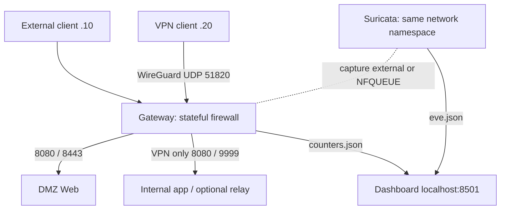

# Integration contract v1

| Nguồn | Đích | Port | Chính sách |
|---|---|---|---|
| External | DMZ web | TCP 8080,8443 | Allow new + established |
| External | Internal | Any | Drop |
| DMZ | Internal | Any new | Drop |
| Internal | DMZ web | TCP 8080,8443 | Allow |
| VPN client external IP | Gateway | UDP 51820 | Allow nếu VPN_ENABLED=1 |
| VPN tunnel 10.77.0.2 | Internal app/relay | TCP 8080/9999 | Allow |
| VPN tunnel | DMZ web | TCP 8080,8443 | Allow |
| Các kết nối khác | Qua gateway | Any | Drop |

Firewall export /logs/counters.json: {timestamp: Unix seconds, rules:[{rule,packets,bytes}]}; ghi atomic mỗi 2 giây. Suricata eve.json: JSON Lines, event_type=alert, timestamp, src_ip, dest_ip, alert.signature, signature_id, action. Dashboard GET /api/snapshot: status, recent_alert_count, by_signature, alerts (tối đa 500 gần nhất, TV4 v2), firewall. Các counter reset khi restart gateway, không cộng dồn qua phiên. Log IDS chỉ tính cửa sổ 512 KiB gần cuối, không phải lịch sử toàn bộ. Dashboard không có chức năng đổi luật. TV4 v2 bổ sung sources, generated_at, mode, window, by_source, by_action, by_severity, timeline và GET /api/alerts.csv. CSV là cửa sổ mới, không lọc theo UI.

MSSV do trưởng nhóm xác nhận, scripts/configure.py sinh .env và generated.rules. Không commit hai file sinh tự động. SIDs 1000001–1000007 giữ ổn định; mở rộng từ 1000010 trở lên. Chạy configure sau khi sửa local.rules.in. Chỉ gateway và Suricata được quyền NET_ADMIN để thay đổi firewall/IPS; endpoint có NET_ADMIN chỉ để cấu hình route; không dùng privileged/host network. Cần đánh giá và giảm capability ở bản cuối nếu khả thi.
