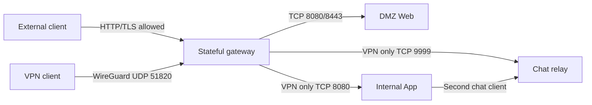

# Báo cáo kỹ thuật — TV2: VPN và dịch vụ bảo mật

## 1. Yêu cầu và phạm vi
Theo đề BTL2 mục 2.1, nhóm phải cấu hình phân vùng mạng, luật Stateful Firewall và kênh truyền VPN cho người dùng từ xa. TV2 triển khai kênh truyền WireGuard giữa client External và Security Gateway, tích hợp dịch vụ Web DMZ và Internal HTTP, tận dụng CA và ứng dụng Chat của BTL1. TV1 chịu trách nhiệm quy hoạch IP và luật Firewall. TV3/TV4 chịu trách nhiệm IDS/IPS và hiển thị nhật ký. Không mở lab ra Internet.

## 2. Thiết kế

| Đối tượng | Địa chỉ | Vai trò |
|---|---|---|
| External client | 172.28.50.10 | Đối chứng không có VPN |
| VPN client | 172.28.50.20 / 10.77.0.2 | Peer từ xa mô phỏng |
| Gateway | 172.28.50.254 / 10.77.0.1 | UDP 51820, chuyển tiếp và lọc |
| Web DMZ | 10.(MSSV mod 200).1.10 | HTTP 8080, TLS 8443 |
| Internal app | 172.28.60.10 | TCP 8080 |
| Chat relay | 172.28.60.30 | TCP 9999 |

VPN sử dụng khóa tĩnh công khai/riêng của mỗi peer, `AllowedIPs` kiểm soát địa chỉ của peer và chọn tunnel cho lưu lượng. Gateway chỉ chấp nhận nguồn 10.77.0.2/32 từ peer client; định tuyến phân tách chỉ chọn mạng Internal và DMZ. WireGuard thực hiện xác thực và mã hóa lưu lượng; luật iptables TV1 kiểm soát dịch vụ cụ thể, không coi việc kết nối VPN là quyền truy cập mọi cổng. Không NAT, giữ địa chỉ nguồn tunnel để đối chiếu policy và log.

TLS dùng CA nội bộ tái sử dụng lớp PrivatePKIManager từ BTL1. Chứng thư server có SAN DNS dmz-web và IP DMZ, client phải kiểm tra chuỗi tin cậy và SAN. Chỉ CA cert công khai được chuyển sang client thông qua volume, private key không chia sẻ. Dịch vụ HTTPS không phản chiếu marker. Dịch vụ HTTP tách riêng nhằm phục vụ IDS phân tích payload trong lab; đây không phải ứng dụng nghiệp vụ có lỗ hổng thật.

Chat reuse framing 4 byte big-endian, giao thức HELLO/HMAC, RSA-OAEP, RSA-PSS và AES-GCM BTL1. Relay mù chỉ chuyển frame, không giải mã chat; client demo trao đổi thông điệp cố định và ACK mã hóa. Giao thức BTL1 sử dụng khóa HMAC từ MSSV công khai và public key chưa được xác thực độc lập; không chứng minh an toàn trước MitM chủ động. WireGuard xác thực peer đã provision key; không thay thế xác thực danh tính người dùng ở lớp ứng dụng. Relay chỉ hỗ trợ 1 cặp tại một thời điểm.

## 3. Hiện thực
- `wireguard/init.sh` sinh key riêng, không thay key tồn tại hợp lệ; kiểm tra key, phân phối public key chéo. `common.sh` kiểm tra định dạng và đối chiếu private/public. `gateway.sh`/`client.sh` lập wg0 và xóa interface vừa tạo nếu startup lỗi; không xóa interface tồn tại trước đó. `start.sh` xác minh cấu hình route.
- `service.py` chạy HTTP và TLS, giới hạn request body 4096 byte, chống nhập nhằng Content-Length, không log payload, thời gian chờ socket hữu hạn. TLS >=1.2; file bí mật tạm được xóa khi nạp context xong. CA rotate mỗi restart.
- `legacy/protocol.py` giới hạn frame 1 MiB, kiểm tra frame thiếu. `legacy/server.py` chạy nhiều phiên tuần tự, đóng socket và giải phóng phiên khi có lỗi. `chat_demo.py` không in khóa, kiểm tra message và ACK. BTL1 client cũ giữ nguyên chỉ để tham khảo, không bảo chứng truyền file.
- `compose.lab.yaml` dùng image TV1 (cần merge TV1), 3 mạng internal của Docker, không privileged/host network/host ports. `compose.chat.yaml` là overlay tùy chọn nâng image vpn-client của Compose chung để demo Chat.

## 4. Đánh giá

Kết quả kiểm thử offline và TCP loopback được ghi trong VALIDATION.md. Không có Docker/WireGuard kernel trong môi trường tạo patch, vì vậy 14 ca lab dưới đây là **tiêu chí nghiệm thu, chưa phải kết quả thực nghiệm**. Sau khi chạy `python tests/member2_vpn/lab_check.py`, lưu stdout, thời điểm, phiên bản Docker/kernel, MSSV và ảnh đã che thông tin khóa.

| ID | Tiêu chí | Kết quả trên Docker |
|---|---|---|
| VPN01 | Route qua wg0; endpoint vẫn External | Chưa chạy |
| VPN02 | External → DMZ HTTP thành công | Chưa chạy |
| VPN03 | External → Internal bị chặn và counter tăng | Chưa chạy |
| VPN04 | DMZ → Internal bị chặn và counter tăng | Chưa chạy |
| VPN05 | VPN → Internal thành công, handshake hai đầu, transfer tăng | Chưa chạy |
| VPN06 | VPN → DMZ thành công | Chưa chạy |
| VPN07 | VPN → cổng không cấp phép bị chặn, counter tăng | Chưa chạy |
| TLS01 | HTTPS ngoài VPN, CA và IP đúng | Chưa chạy |
| TLS02 | HTTPS qua VPN, CA và IP đúng | Chưa chạy |
| TLS03 | HTTPS không tin CA bị từ chối | Chưa chạy |
| TLS04 | HTTPS sai SAN bị từ chối | Chưa chạy |
| HTTP01 | POST marker không phản chiếu | Chưa chạy |
| CHAT01 | Hai client Chat qua VPN/Internal thành công | Chưa chạy |
| CHAT02 | Lặp lại phiên Chat mới thành công | Chưa chạy |

Không sử dụng số liệu hiệu năng hoặc độ chính xác khi chưa đo. Có thể đo RTT của nhiều yêu cầu HTTP qua tunnel sau khi chạy lab, ghi median/p95 và cấu hình máy, nhưng không phải phép so sánh tương đương HTTP trực tiếp nếu đích và policy khác nhau. Không chạy thử tải lên mạng thật.

## 5. Kết luận và hướng phát triển
Đã hiện thực mã nguồn VPN và dịch vụ theo hợp đồng TV1; cần nghiệm thu kernel và Compose thật trước khi công bố hoạt động đầy đủ. Hạn chế: một peer VPN, CA fixture rotate, không xác thực danh tính chat đáng tin cậy, không kiểm thử file transfer, không CA offline/OCSP, không quản lý khóa sản xuất. Hướng phát triển: quản lý nhiều peer, tách CA và pin chứng thư theo kênh provisioning tin cậy, bổ sung xác thực peer Chat có danh tính và kiểm thử an toàn, log metadata không chứa bí mật.

Tài liệu kỹ thuật: đề BTL2 trong refs, BTL1 source đã tích hợp tại legacy, WireGuard https://www.wireguard.com/quickstart/, Python ssl https://docs.python.org/3/library/ssl.html. Các URL là tài liệu tham khảo đề xuất, chưa truy cập trong lần tạo patch.
